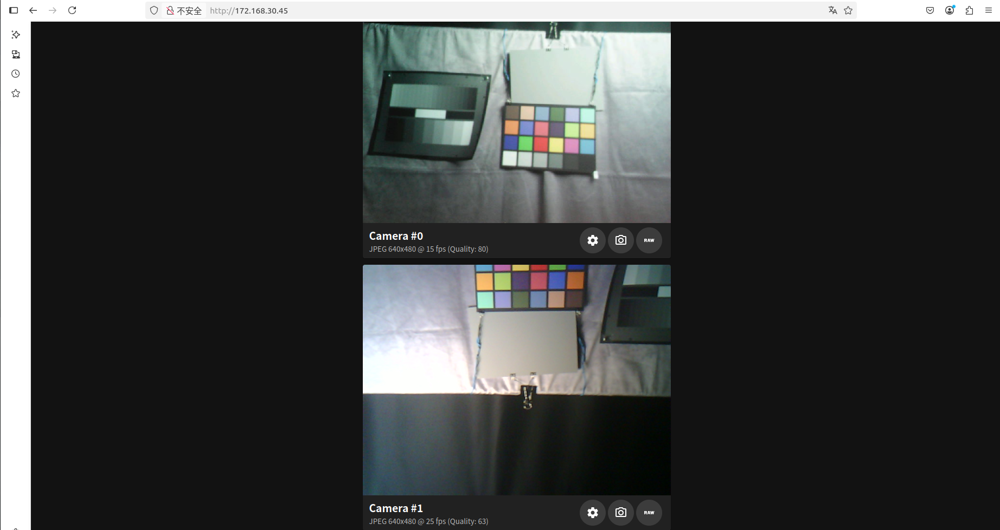

# Face Landmark Cam — ESP32-P4 + OV5647

Hệ thống **phát hiện buồn ngủ** chạy hoàn toàn trên **ESP32-P4** (Waveshare ESP32-P4-Module-DEV-KIT) với camera **OV5647 NoIR (MIPI-CSI)**:

- phát hiện khuôn mặt (esp-dl `HumanFaceDetect`, MSR+MNP) → **landmark** (model **PFLD**) → phân loại **mắt mở/nhắm** (model `open_closed_eye`) + tỉ lệ miệng **MAR**;
- **calibration theo phiên** cho từng người, cảnh báo **nhắm mắt** và **ngáp**;
- phát **âm thanh cảnh báo** ra loa (codec ES8311 + chân SPK trên board);
- stream MJPEG có overlay (khung mặt, landmark, chỉ số, banner cảnh báo) lên trình duyệt qua Wi-Fi.

Pipeline và cảnh báo chạy **độc lập với trình duyệt**: không ai mở web, hoặc Wi-Fi chưa lên, thì vẫn nhận diện và vẫn kêu loa.



> Project được tách ra từ example `17_simple_video_server` của [waveshareteam/ESP32-P4-Platform](https://github.com/waveshareteam/ESP32-P4-Platform).

## Tính năng

- Camera OV5647 `800x800 @ 50 fps` (RAW8 → ISP → RGB565), JPEG phần cứng.
- Một task capture riêng lấy **mọi frame** camera và đưa vào pipeline; chỉ nén JPEG khi có client đang xem.
- Face pipeline trên **core 1** riêng (core 0 lo HTTP, Wi-Fi, capture, loa):
  - detector mỗi 10 frame camera (~5 lần/s), giữa các lần dùng lại box gần nhất;
  - PFLD + model mắt chạy liên tục, rảnh lúc nào chạy lúc đó (~12–15 lần/s với 1 mặt);
  - tối đa 4 khuôn mặt, tối đa 106 điểm landmark mỗi mặt.
- Phát hiện buồn ngủ:
  - **calibration 3 s** khi có mặt mới xuất hiện (nhìn camera, mắt mở, miệng ngậm) → ngưỡng riêng cho người đó;
  - **nhắm mắt** liên tục ≥ 0,8 s → `EYES CLOSED!` + còi lặp lại;
  - **ngáp** (miệng mở rộng) ≥ 1,5 s → `YAWN!` + âm báo;
  - tự calibration lại khi mất mặt > 3 s hoặc khoảng cách thay đổi nhiều; có API calibration lại thủ công.
- Web UI (Vue, đã gzip và nhúng vào firmware) + REST API; mDNS `http://esp-web.local`.

## Phần cứng

| Thành phần | Ghi chú |
|:--|:--|
| Board | Waveshare ESP32-P4-Module-DEV-KIT (ESP32-P4, 16 MB flash, PSRAM) |
| Camera | OV5647 MIPI-CSI (bản NoIR) |
| Mạng | Wi-Fi qua ESP32-C6 trên board (`esp_wifi_remote` / ESP-Hosted, SDIO slot 1) |
| Loa | Cắm vào header **SPK** trên board (codec ES8311 + ampli có sẵn) |

| Tín hiệu | GPIO |
|:--|:--|
| I2C SDA / SCL (camera SCCB **và** ES8311 @0x18 dùng chung bus I2C0, 100 kHz) | 7 / 8 |
| I2S MCLK / BCLK / WS / DOUT (ES8311) | 13 / 12 / 10 / 9 |
| Bật ampli loa (active high) | 53 |

Bus I2C được tạo một lần trong `app_camera.c` rồi chia cho `esp_video` (SCCB) và codec âm thanh.

## Cấu trúc thư mục

```
face_landmark_cam/
├── main/
│   ├── main.c               # app_main: NVS, camera, loa, capture, mạng, mDNS, web server
│   ├── app_camera.c/.h      # Bus I2C dùng chung, MIPI-CSI + OV5647, wrapper JPEG encoder phần cứng
│   ├── web_cam_server.c/.h  # Task capture + HTTP server: web UI, REST API, MJPEG stream
│   ├── face_pipeline.cpp/.h # Detector + PFLD + model mắt, calibration, cảnh báo, vẽ overlay
│   ├── audio_alert.c/.h     # ES8311 + I2S: phát âm cảnh báo không chặn (task riêng)
│   ├── Kconfig.projbuild    # Menu "Example Configuration"
│   └── idf_component.yml    # Dependencies
├── config/                  # Profile sdkconfig cho ESP32-P4 rev 3.x
├── models/
│   ├── pfld.espdl           # Landmark (nhúng vào flash rodata)
│   └── open_closed_eye.espdl# Phân loại mắt mở/nhắm (INT8)
├── frontend/                # Mã nguồn web UI; bản build nằm trong frontend/gzipped
├── partitions.csv           # App factory 6 MB
└── sdkconfig.defaults
```

### Luồng xử lý

```
                      core 0                                              core 1
OV5647 ─MIPI-CSI─► ISP ─► frame RGB565
                          │
             cam_capture task (mọi frame, ~50 fps)
                          ├─► face_pipeline_submit() ──copy frame (khi worker rảnh)──► face_pipeline task
                          │                                                     ├─ HumanFaceDetect (mỗi 10 frame)
                          │                                                     ├─ crop + PPA resize ─► PFLD ─► landmark
                          │                                                     ├─ crop mắt ─► open_closed_eye ─► P(nhắm)
                          │                                                     ├─ EAR / MAR, calibration, cảnh báo
                          │                                                     └─► audio_alert_play() ─► loa
                          │
                          └─ chỉ khi có client: vẽ overlay ─► JPEG HW ─► /stream (:81), /api/capture_image (:80)
```

Thời gian trên core 1 (đo trên board): detector ~21 ms/lần, PFLD + 2 lần model mắt ~63 ms/mặt.

## Yêu cầu phần mềm

- ESP-IDF **>= 5.4** (đang build với v5.5.2).
- Component tải tự động qua Component Manager: `esp_video`, `mdns`, `esp_wifi_remote`, `esp_codec_dev`, `cjson`.
- **esp-dl `human_face_detect`**: đang trỏ tới bản local trong [main/idf_component.yml](main/idf_component.yml):

  ```yaml
  espressif/human_face_detect:
    version: "*"
    override_path: "/home/phong/esp/esp-idf/esp-dl/models/human_face_detect"
  ```

  Nếu clone ở máy khác, sửa `override_path` cho đúng vị trí repo [esp-dl](https://github.com/espressif/esp-dl) (hoặc bỏ `override_path` để dùng bản trên registry).

## Build & flash

```bash
git clone <url-repo-này> face_landmark_cam
cd face_landmark_cam
idf.py set-target esp32p4      # chỉ cần lần đầu
idf.py menuconfig              # cấu hình Wi-Fi (xem bên dưới)
idf.py build flash monitor
```

`CMakeLists.txt` tự áp profile chip trong [config/](config/) (`esp32p4_rev3_x.defaults`) cùng với `sdkconfig.defaults`, trừ khi bạn tự đặt `SDKCONFIG_DEFAULTS`.

> Sau khi đổi `sdkconfig.defaults` hoặc đổi tên/di chuyển thư mục, chạy `idf.py fullclean` (hoặc xoá `build/` và `sdkconfig`) để cấu hình được tạo lại.

## Cấu hình (`idf.py menuconfig`)

### Mạng — *Example Connection Configuration*

- **Wi-Fi SSID / Password** của mạng cần kết nối.
- Với Wi-Fi remote: chip slave là ESP32-C6 (menu **Wi-Fi Remote** / **ESP-Hosted**).

### Ứng dụng — *Example Configuration*

| Tuỳ chọn | Mặc định | Ý nghĩa |
|:--|:--:|:--|
| `EXAMPLE_CAMERA_VIDEO_BUFFER_NUMBER` | 2 | Số buffer V4L2 của camera |
| `EXAMPLE_JPEG_COMPRESSION_QUALITY` | 80 | Chất lượng JPEG của stream (1–100) |
| `EXAMPLE_MDNS_HOST_NAME` | `esp-web` | Tên host → `esp-web.local` |
| `APP_HTTP_SERVER_TASK_CORE` | 0 | Core của HTTP, capture, loa (khác core pipeline) |
| `APP_HTTP_SERVER_TASK_PRIORITY` | 5 | Priority HTTP server |
| `APP_CAPTURE_TASK_PRIORITY` | 6 | Priority task capture (cao hơn HTTP để không rớt frame) |
| **OV5647 (MIPI-CSI) connection** | | I2C port 0, SCL 8, SDA 7, 100 kHz, reset/PWDN = -1 |
| `APP_FACE_PIPELINE_ENABLE` | y | Bật/tắt face pipeline |
| `APP_FACE_DETECT_EVERY_N_FRAMES` | 10 | Detector mỗi N frame **camera** (50 fps → ~5 lần/s) |
| `APP_PFLD_EVERY_N_FRAMES` | 1 | PFLD mỗi N frame camera (1 = nhanh nhất worker cho phép) |
| `APP_EYE_CLASSIFIER_ENABLE` | y | Dùng model mắt cho cảnh báo nhắm mắt (tắt = dùng EAR) |
| `APP_FACE_PIPELINE_TASK_CORE` | 1 | Core dành riêng cho pipeline |
| `APP_FACE_PIPELINE_TASK_PRIORITY` | 10 | Priority task pipeline |
| `APP_FACE_PIPELINE_TASK_STACK` | 16384 | Stack task pipeline |
| **Speaker alerts** → `APP_AUDIO_ALERT_ENABLE` | y | Bật âm thanh cảnh báo |
| `APP_AUDIO_ALERT_VOLUME` | 80 | Âm lượng loa (0–100) |
| `APP_AUDIO_ALERT_REPEAT_MS` | 1500 | Lặp còi nhắm mắt mỗi N ms khi vẫn còn nhắm |
| `APP_AUDIO_ALERT_CALIB_SOUND` | y | Kêu "ting-tong" khi calibration xong |

Các ngưỡng phát hiện buồn ngủ (thời gian calibration, tỉ lệ EAR, delta MAR, thời gian giữ trước khi cảnh báo, ngưỡng P(nhắm)…) là `#define` ở đầu [main/face_pipeline.cpp](main/face_pipeline.cpp), có chú thích từng giá trị.

### Các thiết lập quan trọng trong `sdkconfig.defaults`

- Cảm biến: chỉ OV5647, `MIPI_RAW8_800X800_50FPS`; chỉ bật MIPI-CSI + ISP trong `esp_video`.
- PSRAM 200 MHz, `SPIRAM_XIP_FROM_PSRAM`, L2 cache 256 KB / line 128 B, `-O2`, `FREERTOS_HZ=1000` — cần cho tốc độ esp-dl.
- Chia core: pipeline ở core 1; main, timer, lwIP, mDNS, pthread ở core 0.
- Model detector `MSRMNP_S8_V1` trong flash rodata; bảng phân vùng custom với app factory 6 MB.

## Sử dụng

1. Cắm loa vào header SPK, cấp nguồn, mở monitor. Khi khởi động loa kêu **một tiếng beep** (= loa OK).
2. Nhìn thẳng camera, **mắt mở, miệng ngậm** ~3 giây: màn hình hiện `CALIBRATING - EYES OPEN MOUTH CLOSED`, xong thì loa kêu "ting-tong".
3. Nhắm mắt ≥ 0,8 s → banner đỏ `EYES CLOSED!` + còi lặp lại mỗi 1,5 s cho tới khi mở mắt. Ngáp ≥ 1,5 s → banner cam `YAWN!` + âm báo.
4. Xem stream: mở `http://esp-web.local/` (hoặc `http://<IP>/`). Dưới mỗi khung mặt có dòng chỉ số, ví dụ `EYE 0.12/0.60 MAR 0.05/0.21` (giá trị hiện tại / ngưỡng).

### Log

```
web_cam_server: capture: camera 50.0 fps | stream jpeg 12.3 fps (encode avg 9.1 ms) | clients 1
face_pipeline:  faces=1 | detect 5.0/s avg 21.0 ms | pfld 12.5/s avg 63.0 ms/face | eye avg 6.20 ms/eye
face_pipeline:  face 0: box=(...) score=0.93 landmarks=98 EAR=0.281 MAR=0.042 P(closed)=0.08
face_pipeline:    face 0 pts 0:(x,y) 1:(x,y) ...
```

- Dòng `capture` (5 s/lần): fps thật của camera và của stream.
- Dòng `face_pipeline` (3 s/lần): tốc độ detector/PFLD, kèm toạ độ landmark và trạng thái cảnh báo của từng mặt.

### HTTP API

| Cổng | Endpoint | Method | Mô tả |
|:--:|:--|:--:|:--|
| 80 | `/` | GET | Web UI |
| 80 | `/api/capture_image?source=0` | GET | Ảnh JPEG mới nhất (có overlay) |
| 80 | `/api/capture_binary?source=0` | GET | Frame thô RGB565 (không overlay) |
| 80 | `/api/get_camera_info` | GET | Độ phân giải, định dạng, chất lượng JPEG |
| 80 | `/api/set_camera_config` | POST | Đổi cấu hình (JSON: `index`, `image_format`, `jpeg_quality`) |
| 80 | `/api/recalibrate` | GET | Calibration lại ngay (nhìn camera, mắt mở, miệng ngậm) |
| 81 | `/stream` | GET | Luồng MJPEG (nhiều client cùng lúc được) |

```bash
curl -o snap.jpg "http://esp-web.local/api/capture_image?source=0"
curl http://esp-web.local/api/recalibrate
```

## Model

| Model | File | Ghi chú |
|:--|:--|:--|
| Face detector | esp-dl `human_face_detect` (MSRMNP_S8_V1) | Flash rodata |
| Landmark PFLD | [models/pfld.espdl](models/pfld.espdl) | Symbol `_binary_pfld_espdl_start`; input/output đọc từ model lúc chạy (log `PFLD input [...]`), số điểm = `output_size / 2` |
| Mắt mở/nhắm | [models/open_closed_eye.espdl](models/open_closed_eye.espdl) | OpenVINO `open-closed-eye-0001` lượng tử INT8; output 0 = nhắm, 1 = mở |

- PFLD: mặt được làm vuông, nới `x1.2`, crop + resize bằng PPA, chuẩn hoá `x / 255` (RGB) — xem `FACE_EXPAND`, `PFLD_MEAN`, `PFLD_STD`, `PFLD_RGB_SWAP`. Thay model: ghi đè `models/pfld.espdl` (output toạ độ `[0,1]` theo input) rồi build lại.
- Model mắt: crop vuông quanh mắt theo landmark (xoay cho 2 khoé mắt nằm ngang, cạnh = 2× khoảng cách khoé), chuyển xám (model huấn luyện trên ảnh IR xám MRL). Ô crop được vẽ lên stream để kiểm tra (`DRAW_EYE_CROPS`).
- Cảnh báo nhắm mắt cần layout landmark 68 hoặc 98 điểm.

## Âm thanh cảnh báo

Module [main/audio_alert.c](main/audio_alert.c) (dùng `esp_codec_dev`, task riêng ở core 0, `audio_alert_play()` không chặn, âm mới ngắt âm đang phát):

| Âm | Khi nào |
|:--|:--|
| BEEP | Khởi động xong (loa OK) |
| CALIB_DONE (784 → 1175 Hz) | Calibration xong |
| EYES_CLOSED (2800 Hz × 6, gấp) | Bắt đầu nhắm mắt, lặp mỗi `APP_AUDIO_ALERT_REPEAT_MS` |
| YAWN (1318 → 988 Hz) | Bắt đầu ngáp (một lần mỗi lần ngáp) |

Nếu codec không khởi tạo được, log báo `speaker alerts disabled` và phần còn lại vẫn chạy.

## Phát triển web UI

Mã nguồn web UI nằm trong [frontend/](frontend/) (xem [frontend/README.md](frontend/README.md)). Sau khi sửa, build và nén lại vào `frontend/gzipped/` (script `compress_dist.sh`), rồi build lại firmware.

## Xử lý sự cố

- **Không thấy camera / lỗi SCCB**: kiểm tra cáp FPC, chân SCL/SDA, I2C port.
- **Không có tiếng**: xem log `ES8311 probe @0x18: ...` (phải là OK), loa cắm đúng header SPK, `APP_AUDIO_ALERT_VOLUME` > 0.
- **Không vào được web**: kiểm tra SSID/password; dùng IP nếu mạng không hỗ trợ mDNS.
- **Calibration không xong / lặp lại**: phải mở mắt khi calibration (bị loại nếu mắt nhắm), mặt đủ to và đủ sáng; gọi `/api/recalibrate` để làm lại.
- **Báo nhắm mắt sai**: xem ô crop mắt trên stream có trùng mắt không, ánh sáng IR có quá chói không; chỉnh `EYE_CLOSED_P` / `EYES_CLOSED_ALERT_US`.
- **`face pipeline disabled`**: thiếu bộ nhớ hoặc frame không phải RGB565 — kiểm tra PSRAM và cấu hình sensor.
- **App quá lớn cho phân vùng**: tăng `factory` trong `partitions.csv` (flash 16 MB).
